# SJA-UTA: Sistema Jerárquico Académico UTA

APE 3 · Árbol general y árbol binario de búsqueda (ABB) · Estructura de Datos · Unidad 3

Aplicación de consola en Java que representa la organización académica de la Universidad Técnica de Ambato con un **árbol general** (Universidad, Facultad, Carrera, Nivel y Paralelo) y administra los estudiantes de cada paralelo con un **ABB ordenado por matrícula**. Los dos árboles usan nodos propios y operaciones recursivas, sin `TreeMap` ni `TreeSet`.

## Equipo

| Integrante | Usuario GitHub | Responsabilidad | Estructura / módulo | Misión del reto |
|---|---|---|---|---|
| Chico Yunda Juan Carlos (líder) | juanchicoyunda1234 | Liderazgo, integración final, casos de prueba, README | Orquestación (`app.RetoIntegrador`), casos de prueba | 4 y coordinación de la 6 |
| Torosina Armendariz Jeremy | WinoSpop | Documentación y diagramas | Diagrama de clases, diagrama de la transformación binaria, imágenes de evidencia | 2 |
| Altamirano Segovia Jullisa | jullisaaltamirano2017-boop | Documentación e informe | Informe, comparación de resultados, evidencia de ejecución | 5 |
| Romo Nunez Joseph | wayusa25-cmyk | Backend - Modelo | Paquete `modelo` (`Estudiante`, nodos) | 3 (validaciones) |
| Llamuca Abrajan Andres | llamucaandres161 | Backend - Negocio | Paquete `negocio` (`ArbolOrganizacional`, `ArbolEstudiantes`) | 1, 3 (traslado) y 5 (`contarAprobados`) |
| Tuza Quinatoa Noemi | edithtuza15-collab | Frontend - Integración | Paquete `app` (`Main.java`, menú de consola) | 6 (opción 8) |

## Estructura del proyecto

```
src/
  enums/     TipoUnidad, TipoRecorrido
  modelo/    Estudiante, UnidadAcademica
  negocio/   ArbolOrganizacional, NodoUnidad, ArbolEstudiantes, NodoEstudiante
  app/       Main, Contexto, RetoIntegrador
  pruebas/   PruebasReto, PruebasLenin, PruebasJosue
docs/
  diagramas/     Diagrama de clases y transformación a binario
  informe/       Informes (Reto.md y los del código base)
  tareas/        Tareas del código base
  evidencias/    Salidas reales y capturas del reto
```

Jerarquía inicial: `UTA -> FCHE -> EB -> EB-N1 -> EB-N1-A y EB-N1-B`. `EB-N1-A` tiene nueve matrículas (30, 15, 45, 10, 20, 40, 50, 35, 55) con promedio 8.00 y `EB-N1-B` empieza vacío. La altura se expresa en aristas: un árbol de un solo nodo tiene altura 0 y uno vacío, -1.

## Diagramas

**Diagrama de clases** (`docs/diagramas/diagrama-clases.md`)

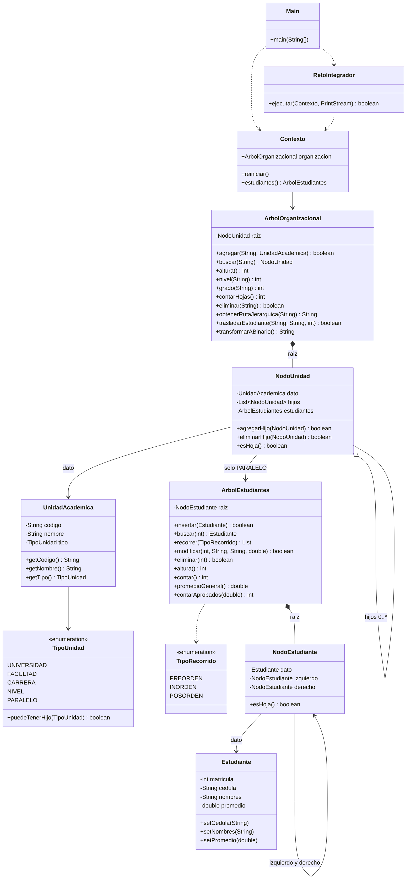

**Transformación del árbol general a binario** (`docs/diagramas/transformacion-binaria.md`). El primer hijo de cada unidad pasa a ser su hijo izquierdo y el siguiente hermano pasa a ser su hermano derecho.

| Árbol general | Árbol binario (hijo izquierdo / hermano derecho) |
|---|---|
| 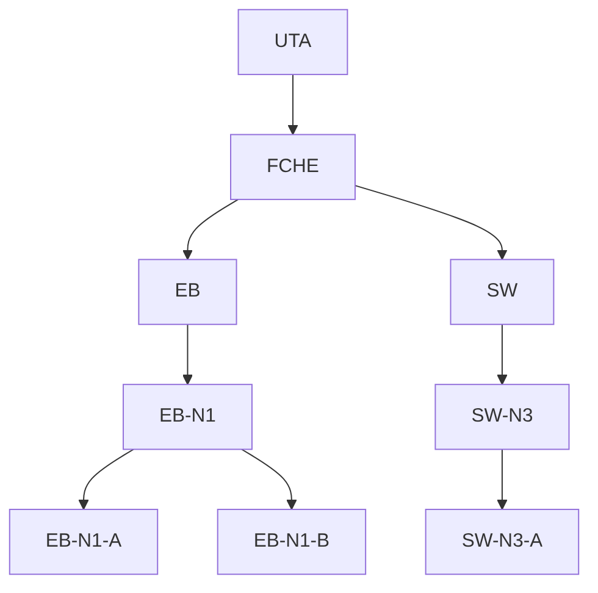 | 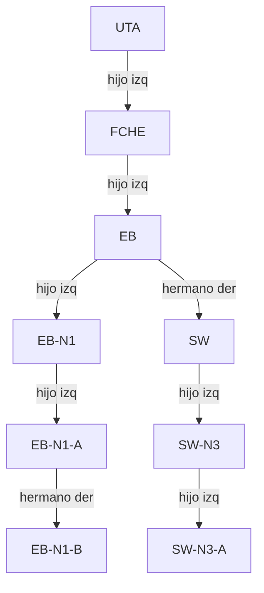 |

## Cómo compilar y ejecutar

Funciona en PowerShell, CMD y bash (Java 17 o superior; se probó con Java 21):

```
javac -encoding UTF-8 -d bin -sourcepath src src/app/Main.java src/pruebas/PruebasReto.java
java -cp bin app.Main
java -cp bin pruebas.PruebasReto
```

Menú principal:

| Opción | Acción |
|---|---|
| 1 | Jerarquía académica |
| 2 | Inserción y búsqueda de estudiantes |
| 3 | Recorridos y estadísticas |
| 4 | Modificación y eliminación de estudiantes |
| 5 | Unidades y transformación binaria |
| 6 | Estado general del sistema |
| 7 | Reiniciar datos de ejemplo |
| **8** | **Ejecutar reto integrador** |
| 0 | Salir |

## Reto práctico integrador

### Reparto de misiones

| Misión | Tema | Responsable | Código |
|---|---|---|---|
| 1 | Jerarquía y ruta institucional | Llamuca Abrajan Andres | `ArbolOrganizacional.obtenerRutaJerarquica` y registro de SW, SW-N3 y SW-N3-A |
| 2 | Protección de unidades y transformación binaria | Torosina Armendariz Jeremy | Verificación de `eliminar` y de `transformarABinario`, diagrama del árbol general frente al binario |
| 3 | Validación de datos y traslado | Romo Nunez Joseph (validaciones) y Llamuca Abrajan Andres (traslado) | `Estudiante` y `ArbolOrganizacional.trasladarEstudiante` |
| 4 | Modificación segura y casos de eliminación del ABB | Chico Yunda Juan Carlos | `ArbolEstudiantes.modificar`, traslados 10, 40, 45 y 30 |
| 5 | Recorridos y estadísticas comparadas | Altamirano Segovia Jullisa (comparación e informe) y Llamuca Abrajan Andres (`contarAprobados`) | `ArbolEstudiantes.contarAprobados` |
| 6 | Integración y reinicio | Tuza Quinatoa Noemi (opción 8 en el menú) y Chico Yunda Juan Carlos (orquestación) | `Main.java`, `RetoIntegrador.java` |

### Qué se implementó

| Archivo | Cambio |
|---|---|
| `negocio/ArbolOrganizacional.java` | `obtenerRutaJerarquica(String)` y `trasladarEstudiante(String, String, int)` |
| `negocio/ArbolEstudiantes.java` | `contarAprobados(double)`, recursivo |
| `app/Main.java` | Opción 8 «Ejecutar reto integrador» |
| `app/RetoIntegrador.java` | Nueva: ejecuta las seis misiones y marca cada verificación con `[OK]` o `[FALLA]` |
| `pruebas/PruebasReto.java` | Nueva: comprueba la repetición de la opción 8 y el reinicio de la opción 7 |

### Decisiones de implementación

- **Ruta jerárquica.** Es recursiva: si el nodo es el buscado devuelve su código; si no, busca en los hijos y antepone el código actual y « -> ». Devuelve «No existe» para códigos nulos, vacíos o ausentes.
- **Eliminación de unidades.** `eliminar` ya rechazaba unidades con subunidades y paralelos con estudiantes, y devolvía `false` si el código no existe. Se verificó con ejecuciones y no hizo falta reforzarla.
- **Transformación binaria.** Solo recorre el árbol y genera texto; se comprobó que la jerarquía antes y después es idéntica.
- **Validaciones.** `Estudiante` ya rechazaba matrícula no positiva y promedios fuera de 0 a 10 o no finitos. Se comprobó con NaN, +Infinity, -Infinity, -0.01 y 10.01, y que un valor rechazado no cambia el guardado.
- **Traslado.** Valida que origen y destino existan, sean distintos y de tipo `PARALELO`, que el estudiante esté en el origen y que la matrícula esté libre en el destino. Inserta primero en el destino y elimina del origen solo si la inserción tuvo éxito. Si la eliminación del origen fallara, quita al estudiante del destino y devuelve `false`; si la reversión también fallara, lanza `IllegalStateException`. En las ejecuciones la eliminación del origen nunca falló, así que esa rama es una protección que no se activó. Los rechazos previos sí se probaron.
- **Modificación segura.** `modificar` valida con un `Estudiante` temporal antes de tocar el registro real, por eso una cédula inválida o un promedio 15 no alteran el registro 35.
- **Opción 8 repetible.** Empieza llamando a `Contexto.reiniciar()`, así repetirla no duplica unidades ni estudiantes. Al terminar deja el estado final del reto para poder consultarlo; la opción 7 reconstruye todo desde cero.

### Resultados de la ejecución real

| Verificación obligatoria | Resultado |
|---|---|
| Ruta de EB-N1-A | `UTA -> FCHE -> EB -> EB-N1 -> EB-N1-A` |
| Eliminar EB-N1-A con estudiantes | Rechazada |
| Eliminar SW-N3-A (hoja vacía) | Posible |
| Altura y hojas tras crear SW | Altura 4, 3 hojas |
| EB-N1-A tras los cuatro traslados | 15, 20, 35, 50, 55 |
| EB-N1-B tras los cuatro traslados | 10, 30, 40, 45 |
| Promedio de EB-N1-A | 8.36 |
| Promedio de EB-N1-B | 8.00 |
| Relaciones binarias | `Hermano Der de EB: SW` y `Hermano Der de EB-N1-A: EB-N1-B` |

Comparación final:

| Dato | EB-N1-A | EB-N1-B |
|---|---|---|
| Inorden | [15, 20, 35, 50, 55] | [10, 30, 40, 45] |
| Cantidad | 5 | 4 |
| Altura (aristas) | 2 | 2 |
| Matrícula menor | 15 | 10 |
| Matrícula mayor | 55 | 45 |
| Promedio general | 8.36 | 8.00 |
| Aprobados (nota mínima 8.00) | 5 | 4 |

La opción 8 supera **94 de 94 verificaciones** y `PruebasReto` supera **11 de 11**: dos ejecuciones seguidas de la opción 8 dejan el mismo estado y, tras la opción 7, las nueve matrículas vuelven a EB-N1-A, EB-N1-B queda vacío y SW, SW-N3 y SW-N3-A dejan de existir.

### Por qué el inorden conserva el orden de matrículas

En un ABB, el subárbol izquierdo de cada nodo contiene solo matrículas menores y el derecho solo mayores. El inorden visita el subárbol izquierdo, luego el nodo y al final el derecho, así que en cada nodo salen primero todas las menores, después la propia y después las mayores. Como la propiedad se cumple en todo el árbol y no se permiten matrículas repetidas, la secuencia sale ascendente. La inserción, la eliminación y el traslado conservan esa propiedad.

### Evidencias

Las imágenes se generaron a partir de la salida real de la ejecución guardada en `docs/evidencias/reto/01_opcion8_ejecucion.txt` y `02_pruebas_reto.txt`; son una representación de esa salida y no capturas de pantalla.

**Misión 1: jerarquía y rutas**

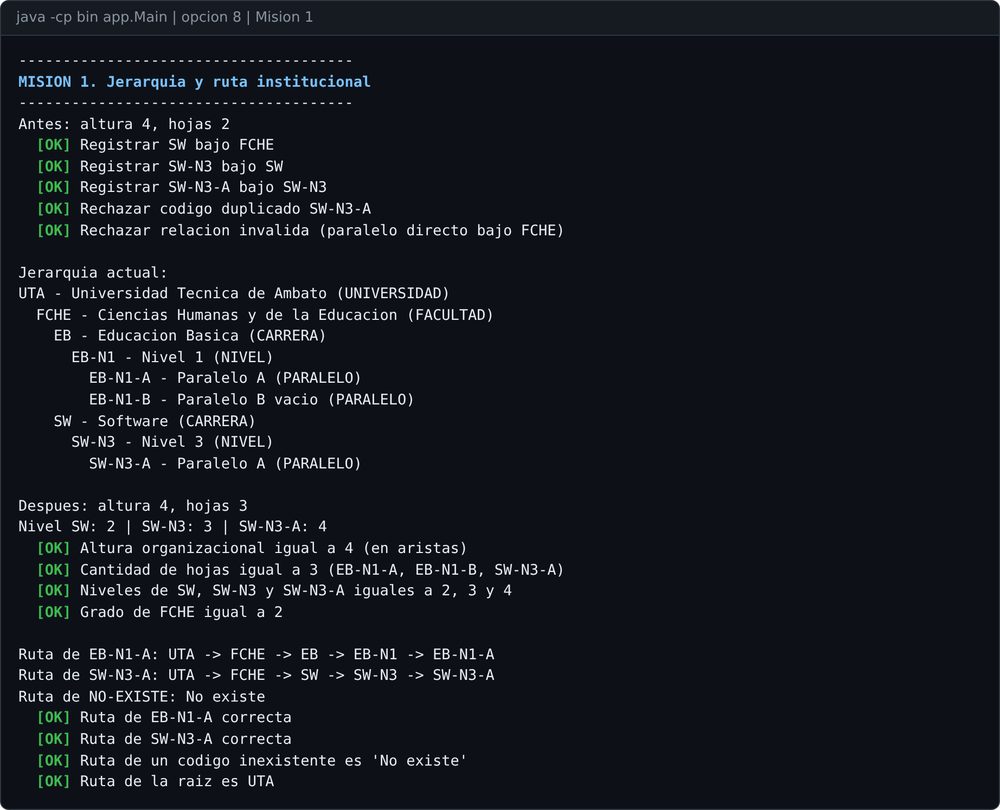

**Misión 2: protección de unidades y transformación binaria**

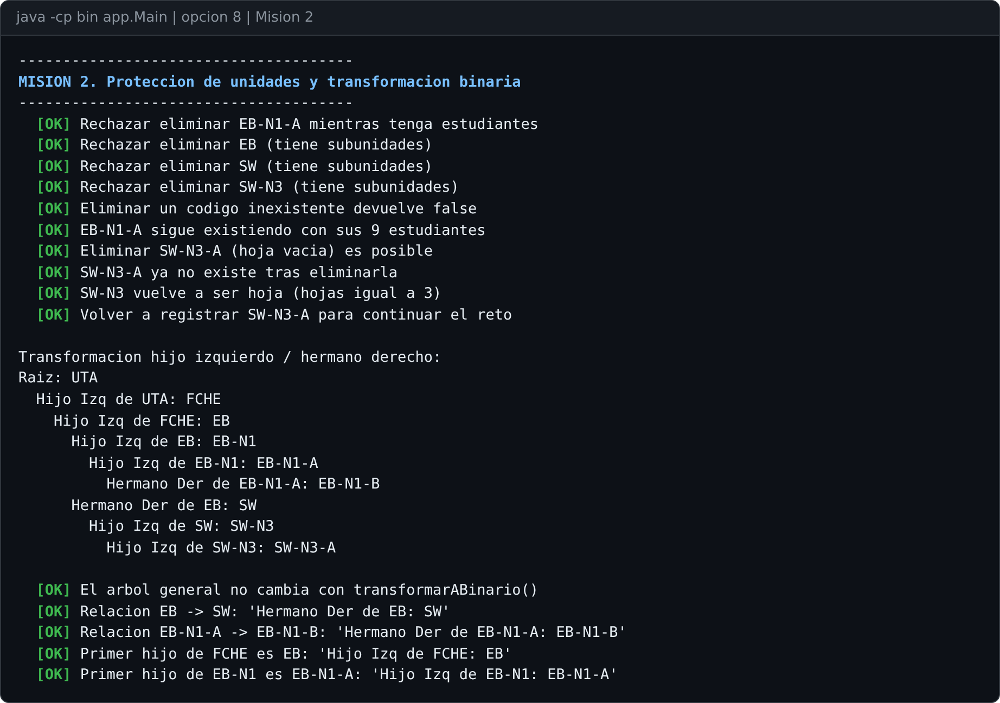

**Misión 3: validaciones y rechazos de traslado**

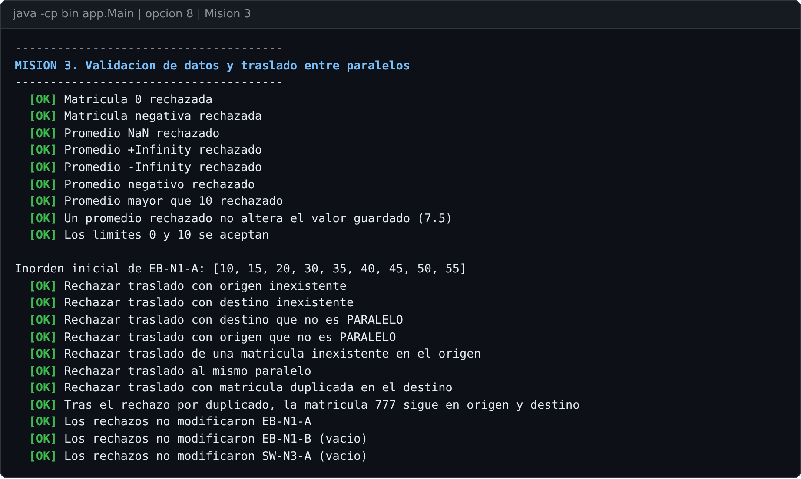

**Misión 4: modificación segura y traslados de 10 y 40**

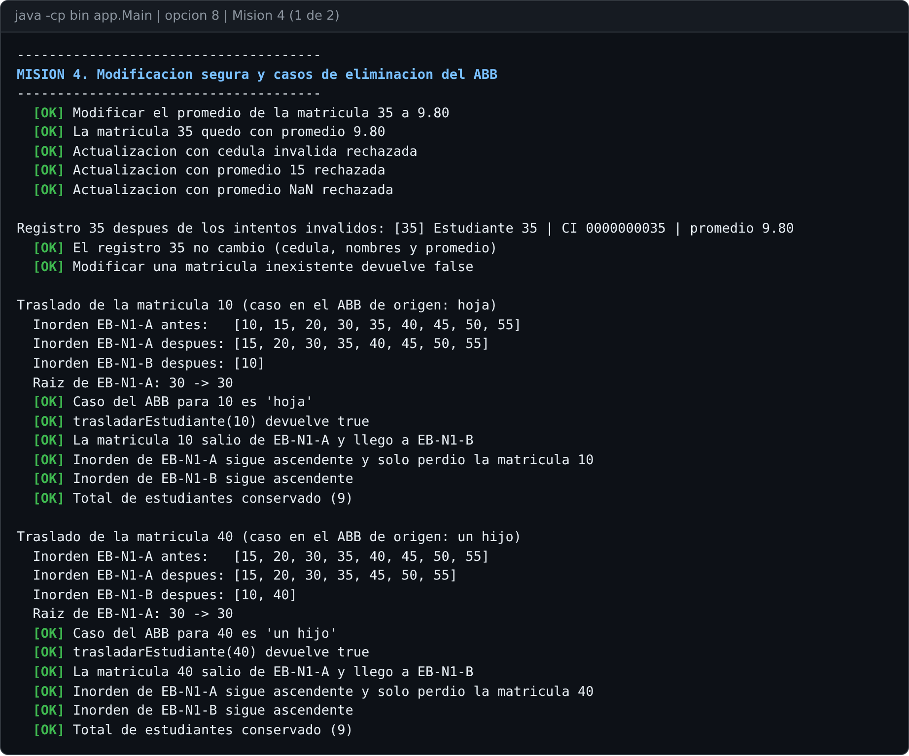

**Misión 4: traslados de 45 (dos hijos) y 30 (raíz)**

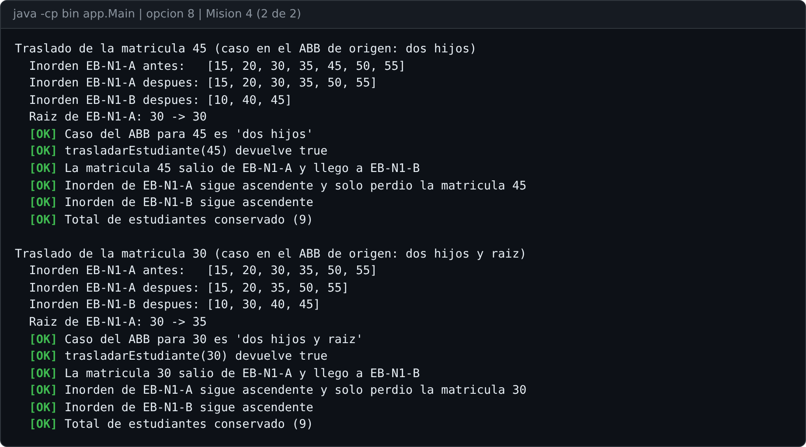

**Misión 5: estadísticas comparadas**

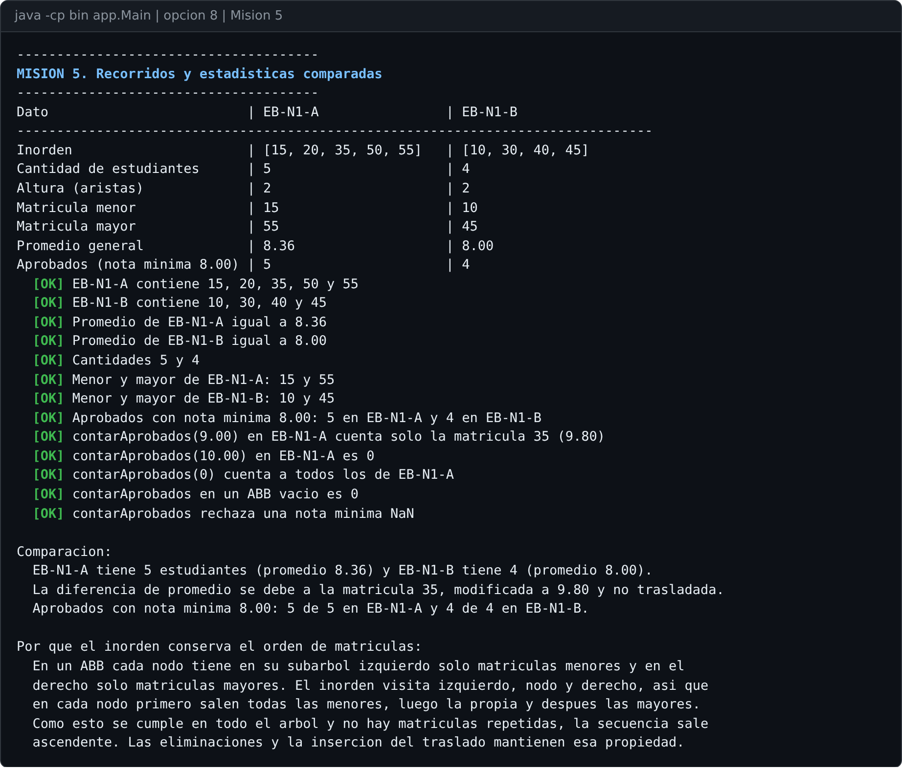

**Misión 6: resumen del reto**

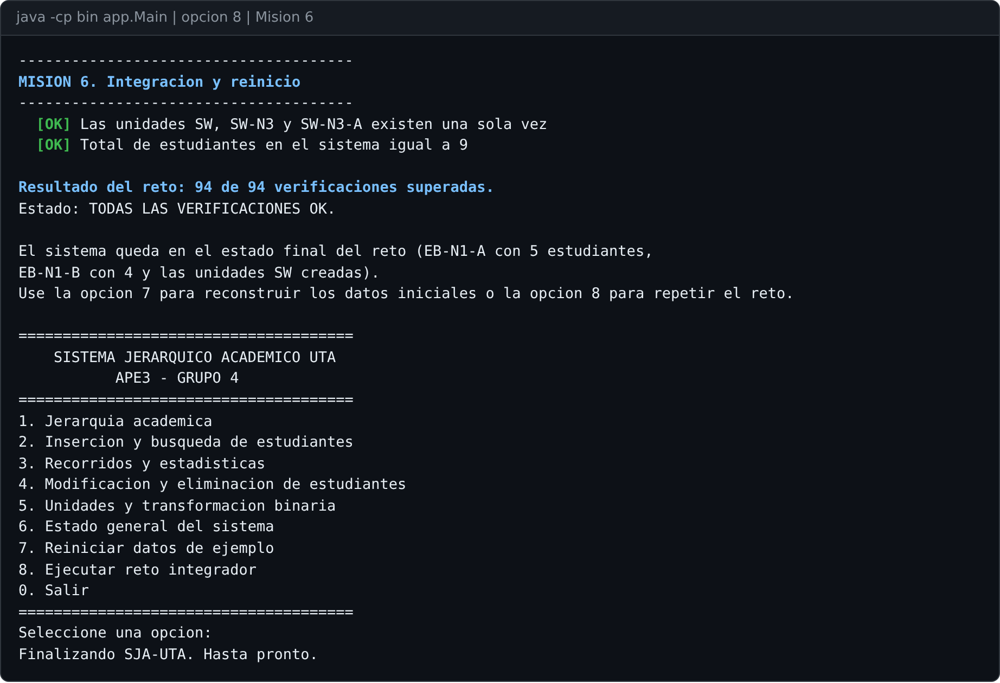

**Repetición de la opción 8 y reinicio con la opción 7**

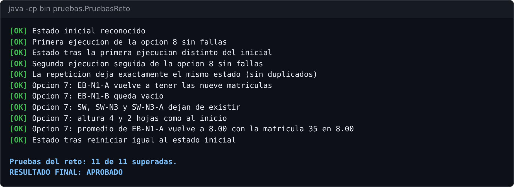

Archivos de texto con la salida completa:

- [Ejecución de la opción 8](docs/evidencias/reto/01_opcion8_ejecucion.txt)
- [Salida de PruebasReto](docs/evidencias/reto/02_pruebas_reto.txt)
- [Menú: opción 8 repetida, opción 7 y consultas posteriores](docs/evidencias/reto/03_menu_repeticion_y_reinicio.txt)
- [Informe del reto](docs/informe/Reto.md)

## Material heredado del código base

Las carpetas `docs/informe` y `docs/tareas` también contienen informes y tareas que venían con el proyecto base entregado para el reto (Andres.md, Cris.md, Hector.md, Josue.md y Lenin.md), junto con las pruebas `PruebasLenin` y `PruebasJosue`. Se conservaron sin cambios.
