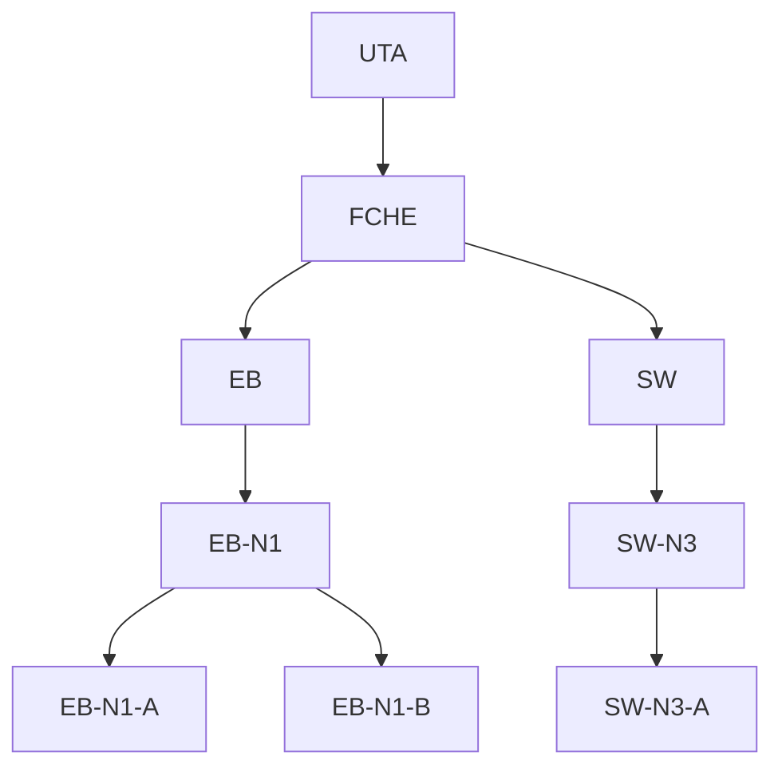
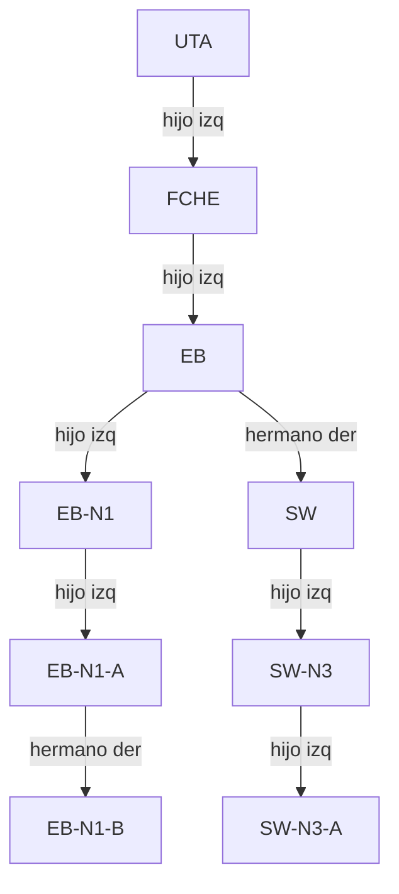

# Transformación del árbol general a binario

Regla: el **primer hijo** de cada unidad pasa a ser su hijo izquierdo y el **siguiente hermano** pasa a ser su hermano derecho. La raíz nunca tiene hermano derecho.

## Árbol general (después de crear SW, SW-N3 y SW-N3-A)

## Árbol binario (hijo izquierdo / hermano derecho)

Estas relaciones coinciden con la salida real de `transformarABinario()` (ver `docs/evidencias/reto/01_opcion8_ejecucion.txt`): `Hermano Der de EB: SW` y `Hermano Der de EB-N1-A: EB-N1-B`.
